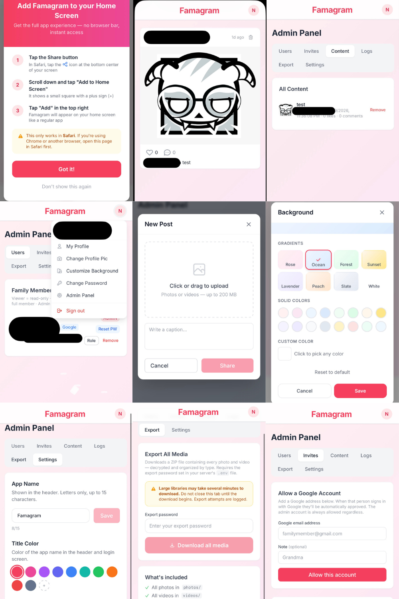

# Famagram

A private, self-hosted photo and video sharing app for families and small groups. All media is encrypted at rest. No third-party cloud storage — everything stays on your server.

---

## Features

- Photo and video sharing feed, with up to 10 photos per post
- Short-video "Vids" page (TikTok-style vertical scroll)
- Likes and comments on all posts
- Profile pages with custom avatars
- Pinch-to-zoom and pan on photos
- Per-user customizable background themes
- Push notifications — choose specific people to be notified about
- Admin panel: user management, invite links, content moderation, media export
- Three user roles: Poster, Reader, Viewer
- Login with email/password or Google OAuth
- Admin-generated password reset links
- Add to Home Screen on iOS and Android (works as a PWA)
- All photos and videos encrypted at rest with AES-256-GCM
- Content blurs automatically when you switch apps (privacy screen)
- Customizable app name and color (up to 15 characters, set in Admin > Settings)

---

## Screenshots

<div align="center">
  <h4>Famagram Options Preview</h4>
  
</div>

---

## Requirements

- [Docker Desktop](https://www.docker.com/products/docker-desktop/) (Mac, Windows, or Linux)
- That's it. Docker pulls everything else automatically.

---

## Quick Start (Recommended — pre-built images)

This is the easiest way to run Famagram. You do **not** need to download the source code.

### 1. Download the two required files

Save these two files into a folder on your machine (e.g. `famagram/`):

- [`docker-compose.deploy.yml`](docker-compose.deploy.yml)
- [`.env.example`](.env.example)

### 2. Create your configuration file

Rename `.env.example` to `.env`:

```bash
cp .env.example .env
```

On Windows, just rename the file in Explorer.

### 3. Fill in the required values

Open `.env` in any text editor and set:

| Variable | What to put |
|---|---|
| `POSTGRES_PASSWORD` | Any strong password for the database (you won't type this regularly) |
| `SESSION_SECRET` | A long random string — run `node -e "console.log(require('crypto').randomBytes(64).toString('hex'))"` or use any 64+ character random string |
| `ENCRYPTION_KEY` | A 64-character hex string — run `node -e "console.log(require('crypto').randomBytes(32).toString('hex'))"` |
| `ADMIN_EMAIL` | Email for the auto-created admin account |
| `ADMIN_PASSWORD` | Strong password (20+ chars, upper, lower, number, symbol) |
| `APP_URL` | Where people will access the app (see below) |

**Setting `APP_URL`:**
- Running on your own laptop: `http://localhost`
- Running on a home server (Raspberry Pi, NAS, etc.): `http://192.168.1.x` (your server's local IP)
- Running on a public server with a domain: `https://photos.yourfamily.com`

> **IMPORTANT — Back up your `.env` file**, especially `ENCRYPTION_KEY`. All photos and videos are encrypted with this key. If you lose it, your media is permanently unrecoverable.

### 4. Start the app

```bash
docker compose -f docker-compose.deploy.yml up -d
```

Docker will download the images (first run takes a few minutes depending on your connection) and start four containers: the database, backend API, frontend, and nginx proxy.

### 5. Open the app

Go to your `APP_URL` in a browser (default: [http://localhost](http://localhost)).

Sign in with the `ADMIN_EMAIL` and `ADMIN_PASSWORD` you set in `.env`.

> Change the admin password after your first login — go to the profile icon > Change Password.

---

## Configuration Reference

Everything above only walks through the handful of values you *must* set. This
section is the full list — every file involved and every environment
variable either deployment method reads — in one place, for reference.

### Files

| Setup | Files you need |
|---|---|
| **Standard (`.env`)** | [`docker-compose.deploy.yml`](docker-compose.deploy.yml), [`.env.example`](.env.example) (copy to `.env`) |
| **Vault** | [`docker-compose.vault.yml`](docker-compose.vault.yml), [`.env.vault.example`](.env.vault.example) (copy to `.env.vault`), `vault/agent.hcl`, `vault/templates/app.env.tpl`, plus `vault/auth/role_id` and `vault/auth/secret_id` — generated by you during setup, never downloaded (see below) |

Nothing else needs to be downloaded for either method — the app itself ships
as pre-built Docker images (`nathanbascom/famagram-{backend,frontend,nginx}`)
that Docker pulls automatically.

### Environment variables — standard (`.env`) setup

| Variable | Required? | What it's for |
|---|---|---|
| `POSTGRES_USER` | No (defaults to `famagram`) | Database username |
| `POSTGRES_PASSWORD` | **Yes** | Database password |
| `SESSION_SECRET` | **Yes** | Signs login session cookies — 64+ random characters |
| `ENCRYPTION_KEY` | **Yes** | AES-256 key all photos/videos are encrypted with. **Back this up** — losing it permanently loses all media |
| `COOKIE_SECURE` | No (defaults to `true`) | Set to `false` only for a plain-HTTP local/LAN deployment |
| `AUTH_MODE` | No (defaults to `local`) | `local`, `google`, or `hybrid` — see **Google OAuth** below |
| `ADMIN_EMAIL` | **Yes** | Email for the auto-created admin account (local auth mode) |
| `ADMIN_NAME` | No (defaults to `Admin`) | Display name for that account |
| `ADMIN_PASSWORD` | **Yes** | Password for that account (20+ chars, upper, lower, number, symbol) |
| `APP_URL` | **Yes** | Full public URL of the app — see Quick Start above |
| `PORT` | No (defaults to `80`) | Host port Docker exposes |
| `GOOGLE_CLIENT_ID` | Only if `AUTH_MODE` is `google`/`hybrid` | See **Google OAuth** below |
| `GOOGLE_CLIENT_SECRET` | Only if `AUTH_MODE` is `google`/`hybrid` | See **Google OAuth** below |
| `GOOGLE_ADMIN_EMAIL` | Only if `AUTH_MODE` is `google`/`hybrid` | Google account auto-granted admin on first login |
| `EXPORT_PASSWORD` | No (feature disabled if blank) | Enables Admin Panel's "export all media" ZIP download — see **Media Export** below |
| `VAPID_PUBLIC_KEY` | No (feature disabled if blank) | Enables push notifications — see **Push Notifications** below |
| `VAPID_PRIVATE_KEY` | No (feature disabled if blank) | Pairs with `VAPID_PUBLIC_KEY`. **Secret** — never share or commit it |
| `VAPID_SUBJECT` | Only if the VAPID keys are set | Contact email/URL required by the Web Push protocol |

### Environment variables — Vault setup

Non-secret settings come from `.env.vault`; secret values come from Vault itself.

**`.env.vault`:**

| Variable | Required? | What it's for |
|---|---|---|
| `VAULT_ADDR` | **Yes** | Your Vault server's URL |
| `VAULT_NAMESPACE` | No | Only for Vault Enterprise namespaces |
| `VAULT_SECRET_PATH` | No (defaults to `secret/data/famagram`) | KV v2 path holding the secret |
| `APP_URL` | **Yes** | Same meaning as the standard setup |
| `PORT` | No (defaults to `80`) | Same meaning as the standard setup |
| `AUTH_MODE` | No (defaults to `local`) | Same meaning as the standard setup |
| `ADMIN_NAME` | No (defaults to `Admin`) | Same meaning as the standard setup |
| `COOKIE_SECURE` | No (defaults to `true`) | Same meaning as the standard setup |
| `VAPID_SUBJECT` | No | Same meaning as the standard setup — not a secret, so it lives here, not in Vault |

**Vault secret fields** (all required at the path set by `VAULT_SECRET_PATH` — leave Google/export/push fields as empty strings if unused):

| Field | Corresponds to |
|---|---|
| `postgres_user` | `POSTGRES_USER` |
| `postgres_password` | `POSTGRES_PASSWORD` |
| `session_secret` | `SESSION_SECRET` |
| `encryption_key` | `ENCRYPTION_KEY` |
| `google_client_id` | `GOOGLE_CLIENT_ID` |
| `google_client_secret` | `GOOGLE_CLIENT_SECRET` |
| `google_admin_email` | `GOOGLE_ADMIN_EMAIL` |
| `admin_email` | `ADMIN_EMAIL` |
| `admin_password` | `ADMIN_PASSWORD` |
| `export_password` | `EXPORT_PASSWORD` |
| `vapid_public_key` | `VAPID_PUBLIC_KEY` |
| `vapid_private_key` | `VAPID_PRIVATE_KEY` |

Plus two generated credential files, not secrets you choose yourself —
produced by `vault write`/`vault read` during setup (see **Fetching Secrets
from HashiCorp Vault** below) and never committed:

| File | What it is |
|---|---|
| `vault/auth/role_id` | The AppRole's Role ID |
| `vault/auth/secret_id` | The AppRole's Secret ID — treat with the same care as a password |

---

## Alternative: Fetching Secrets from HashiCorp Vault

If you run HashiCorp Vault, you can use `docker-compose.vault.yml` instead of `docker-compose.deploy.yml`. It's the same deployment, except secret values (DB password, session secret, encryption key, Google OAuth credentials, admin credentials, export password) are fetched from Vault at container start via a Vault Agent sidecar (AppRole auth) instead of read from `.env`. Non-secret settings (ports, URLs, auth mode) still come from a config file, `.env.vault`. This is entirely optional — most self-hosters should stick with the plain `.env` setup above.

### 1. Download the required files

Save these into your `famagram/` folder, keeping the `vault/` folder structure exactly as shown — `docker-compose.vault.yml` looks for `agent.hcl` and `app.env.tpl` at these specific relative paths, so flattening them into one folder will break the bind mounts:

```
famagram/
├── docker-compose.vault.yml
├── .env.vault.example
└── vault/
    ├── agent.hcl
    └── templates/
        └── app.env.tpl
```

- [`docker-compose.vault.yml`](docker-compose.vault.yml)
- [`.env.vault.example`](.env.vault.example)
- `vault/agent.hcl`
- `vault/templates/app.env.tpl`

### 2. Enable AppRole auth and create a policy in Vault

`<SECRET_LOCATION>` below is the KV v2 mount your Vault stores secrets under — `secret` is Vault's own default, but some setups mount it elsewhere (e.g. `kv`). Run `vault secrets list` if you're not sure which one applies to your server, and use that mount name everywhere `<SECRET_LOCATION>` appears in this section.

```bash
vault auth enable approle

vault policy write famagram - <<EOF
path "<SECRET_LOCATION>/data/famagram" {
  capabilities = ["read"]
}
EOF

vault write auth/approle/role/famagram \
  token_policies="famagram" \
  token_ttl=1h \
  token_max_ttl=4h
```

### 3. Write the secret

All fields below are required (leave Google/export/push fields as empty strings if unused):

```bash
vault kv put <SECRET_LOCATION>/famagram \
  postgres_user="famagram" \
  postgres_password="<REPLACE_WITH_SECRET>" \
  session_secret="<REPLACE_WITH_SECRET>" \
  encryption_key="<REPLACE_WITH_SECRET>" \
  google_client_id="" \
  google_client_secret="" \
  google_admin_email="" \
  admin_email="<REPLACE_WITH_EMAIL>" \
  admin_password="<REPLACE_WITH_SECRET>" \
  export_password="" \
  vapid_public_key="" \
  vapid_private_key=""
```

Generate `session_secret` and `encryption_key` the same way as in the standard `.env` setup (see the Quick Start table above). Generate `vapid_public_key`/`vapid_private_key` with `npx web-push generate-vapid-keys` (see **Push Notifications** below) — leave both blank to disable push entirely.

### 4. Generate the AppRole credentials

```bash
mkdir -p vault/auth

vault read -field=role_id auth/approle/role/famagram/role-id \
  > vault/auth/role_id

vault write -f -field=secret_id auth/approle/role/famagram/secret-id \
  > vault/auth/secret_id
```

`vault/auth/role_id` and `vault/auth/secret_id` are the credentials the Vault Agent sidecar uses to log in. Keep them as private as your `.env` file — never commit or share them.

### 5. Create your configuration file

```bash
cp .env.vault.example .env.vault
```

Open `.env.vault` and fill in:

| Variable | What to put |
|---|---|
| `VAULT_ADDR` | Your Vault server's URL, e.g. `<https://vault.example.com:8200>` |
| `VAULT_NAMESPACE` | Leave blank unless you use Vault namespaces (Enterprise) |
| `VAULT_SECRET_PATH` | `<SECRET_LOCATION>/data/famagram` — using the same `<SECRET_LOCATION>` mount from step 2 |
| `APP_URL` | Same meaning as in the standard setup — see Quick Start above |
| `PORT` | Host port Docker exposes (default `80`) |
| `AUTH_MODE` | `local`, `google`, or `hybrid` |
| `ADMIN_NAME` | Display name for the auto-created admin account |
| `VAPID_SUBJECT` | Contact email/URL for push notifications, e.g. `mailto:admin@example.com` — not a secret; the VAPID key pair itself lives in Vault (step 3) |

### 6. Start the app

```bash
docker compose -f docker-compose.vault.yml --env-file .env.vault up -d
```

The `vault-agent` service authenticates once at startup and renders the secrets into a tmpfs-backed volume (never written to disk); `postgres` and `backend` wait for it to become healthy before starting. Sign in the same way as in the standard setup (Step 5 of Quick Start above).

### Vault-specific troubleshooting

**`vault-agent` never becomes healthy / other containers stuck "Created"**
```bash
docker compose -f docker-compose.vault.yml logs vault-agent
```
Usually means `VAULT_ADDR` is unreachable from inside the container, the AppRole `role_id`/`secret_id` are wrong or expired, or the policy doesn't grant read on `VAULT_SECRET_PATH`.

**Backend fails to start with a Postgres auth error**
Confirm the secret at `VAULT_SECRET_PATH` has non-empty `postgres_user` and `postgres_password` fields — the Postgres container pulls its credentials from the same rendered file.

---

## Useful Commands

> These use `docker-compose.deploy.yml`. If you're running the Vault setup, swap in `-f docker-compose.vault.yml --env-file .env.vault` instead.

```bash
# Check if containers are running
docker compose -f docker-compose.deploy.yml ps

# View logs (all services)
docker compose -f docker-compose.deploy.yml logs -f

# View logs for one service (backend, frontend, nginx, postgres)
docker compose -f docker-compose.deploy.yml logs -f backend

# Stop the app
docker compose -f docker-compose.deploy.yml down

# Stop and delete all data (irreversible)
docker compose -f docker-compose.deploy.yml down -v

# Update to the latest version
docker compose -f docker-compose.deploy.yml pull
docker compose -f docker-compose.deploy.yml up -d
```

---

## Inviting Family Members

1. Log in as an admin.
2. Tap the gear icon (Admin Panel) in the bottom nav.
3. Go to the **Invites** tab and create an invite link.
4. Share the link with the person — they click it, fill in their name, email, and password, and their account is automatically approved.
5. You can set their role before or after they register (Users tab).

---

## User Roles

Managed in **Admin Panel > Users**.

| Role | Can view | Can like/comment | Can upload |
|---|---|---|---|
| **Poster** | Yes | Yes | Yes |
| **Reader** | Yes | Yes | No |
| **Viewer** | Yes | No | No |

Admins have full access to everything including the admin panel, and cannot be removed unless another admin exists.

---

## Admin Panel

Access via the gear icon in the bottom navigation bar (admin accounts only).

| Tab | What it does |
|---|---|
| **Users** | Approve/reject pending accounts, change roles, reset passwords, remove users |
| **Content** | View and delete any post |
| **Invites** | Generate invite links for new members |
| **Logs** | Activity log (logins, uploads, admin actions) |
| **Settings** | Customize the app name and color (up to 15 characters) |

### Resetting a User's Password

1. Admin Panel > Users > find the user > click **Reset PW**
2. Copy the link and send it to the user
3. The link is valid for 24 hours and requires the user to enter their email to confirm

---

## Adding to Home Screen (iOS / Android)

Famagram works as a Progressive Web App (PWA) — it can be installed on a phone's home screen and behaves like a native app.

**iOS (Safari):**
1. Open the app in Safari
2. Tap the Share button (box with arrow)
3. Scroll down and tap **Add to Home Screen**
4. Tap **Add**

**Android (Chrome):**
1. Open the app in Chrome
2. Tap the three-dot menu
3. Tap **Add to Home Screen** or **Install App**

Once installed, the app launches fullscreen with no browser chrome, and the icon appears on your home screen.

---

## Google OAuth (Optional)

Instead of email/password login, you can use Google accounts.

1. Go to [https://console.cloud.google.com/](https://console.cloud.google.com/)
2. Create a project > APIs & Services > Credentials
3. Create an **OAuth 2.0 Client ID** (Web application type)
4. Add an **Authorized Redirect URI**: `https://<yourdomain.com>/api/auth/google/callback` — this must match your `APP_URL` exactly (scheme + host + port)
5. In your `.env` set:

```
AUTH_MODE=google
GOOGLE_CLIENT_ID=<your_client_id_here>
GOOGLE_CLIENT_SECRET=<your_client_secret_here>
GOOGLE_ADMIN_EMAIL=<your.google.email@gmail.com>
```

The callback URL isn't set directly — it's built automatically from `APP_URL` (`<APP_URL>/api/auth/google/callback`), which is why it has to match the redirect URI you registered with Google.

`GOOGLE_ADMIN_EMAIL` is the Google account that automatically receives admin access on first login — set this to your own Google account.

---

## Media Export

Admins can download a ZIP of all photos and videos. To enable this feature, set a password in `.env`:

```
EXPORT_PASSWORD=<a_strong_password_here>
```

Leave it blank to disable export entirely. In the Admin Panel, go to **Content** and use the Export button.

---

## Push Notifications

Users can choose specific other users to get notified about — "tell me when Mom posts," not an all-or-nothing firehose. To enable it, set a VAPID keypair in `.env`:

```
VAPID_PUBLIC_KEY=...
VAPID_PRIVATE_KEY=...
VAPID_SUBJECT=mailto:admin@example.com
```

Generate the keypair with:

```bash
npx web-push generate-vapid-keys
```

Leave both keys blank to disable push notifications entirely — the rest of the app works normally without them.

Each person turns notifications on for themselves from the profile menu (**Notifications**) and picks who to be notified about. The notification itself never contains a caption or photo — just "new post," so nothing private shows up on a lock screen; tapping it opens the real post.

**iOS limitation:** push notifications only work once the app has been added to the Home Screen (Safari's Share > Add to Home Screen), and only on iOS 16.4 or later. There's no way around this — it's an Apple restriction, not something this app can fix. The in-app notification settings screen explains this and walks through the install steps when it detects it's running in regular Safari instead of as an installed app.

---

## Backup and Restore

Two things need to be backed up:

### 1. The `.env` file
This contains your `ENCRYPTION_KEY`. Without it, all media is permanently unrecoverable. Back it up to a secure location (password manager, encrypted drive, etc.).

### 2. Docker volumes

```bash
# Back up the database
docker exec famagram-db pg_dump -U famagram famagram > backup_$(date +%Y%m%d).sql

# Back up uploaded media
docker run --rm \
  -v famagram_uploads_data:/data \
  -v $(pwd):/backup \
  alpine tar czf /backup/uploads_$(date +%Y%m%d).tar.gz -C /data .
```

**To restore:**

```bash
# Restore database
docker exec -i famagram-db psql -U famagram famagram < backup_YYYYMMDD.sql

# Restore media
docker run --rm \
  -v famagram_uploads_data:/data \
  -v $(pwd):/backup \
  alpine tar xzf /backup/uploads_YYYYMMDD.tar.gz -C /data
```

---

## Troubleshooting

**Containers won't start**
```bash
docker compose -f docker-compose.deploy.yml logs
```
Look for error messages. The most common cause is a missing or malformed `.env` value.

**Can't log in / "Not authenticated" errors**
- Make sure `SESSION_SECRET` is set in `.env` and is at least 32 characters
- Make sure `APP_URL` matches the address you're using in the browser exactly (including `http://` vs `https://`)

**Photos not loading / all media broken**
- Your `ENCRYPTION_KEY` may have changed. Media encrypted with a different key cannot be decrypted. Restore from backup.

**Port 80 already in use**
Add `PORT=8080` (or any free port) to your `.env`. Then access the app at `http://localhost:8080`.

**Database migration errors on startup**
The backend runs `prisma migrate deploy` automatically on startup. If a migration fails, check the backend logs:
```bash
docker compose -f docker-compose.deploy.yml logs backend
```

**Reset everything and start fresh**
```bash
docker compose -f docker-compose.deploy.yml down -v
docker compose -f docker-compose.deploy.yml up -d
```
This deletes all data including the database and uploaded media. Only do this on a fresh install.
